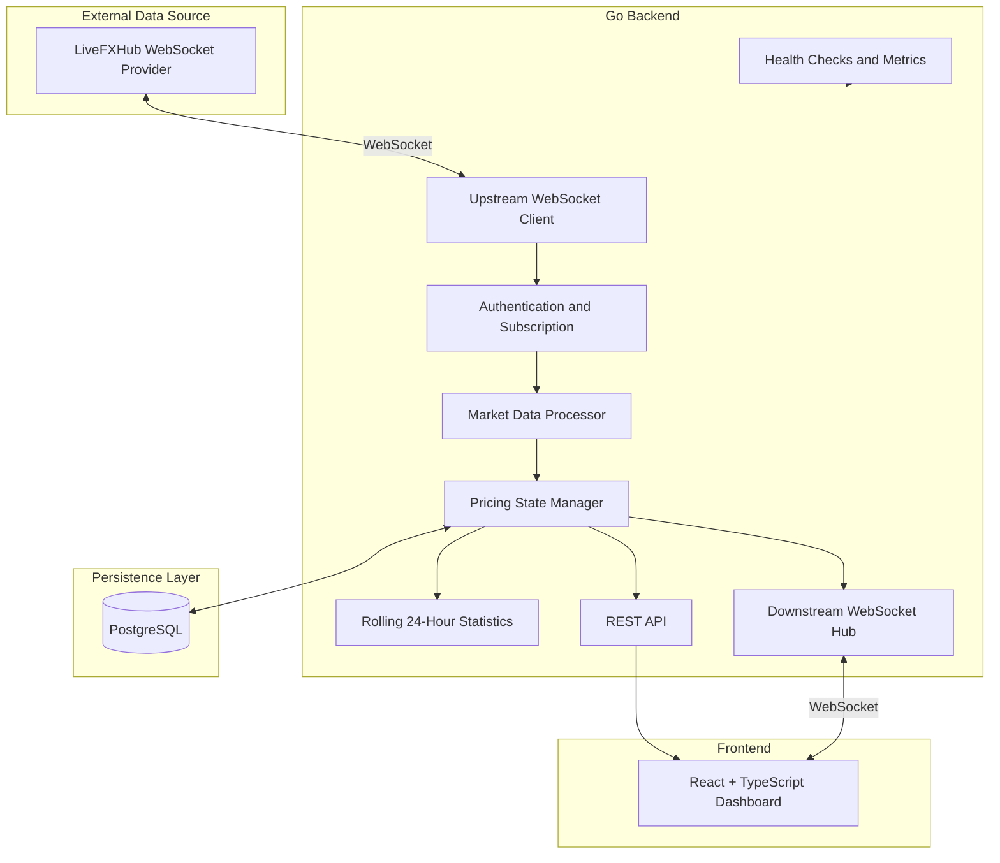
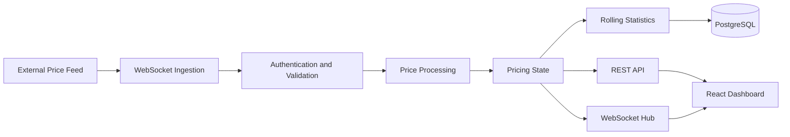

# Real-Time Pricing Engine

### Low-Latency Market Data Processing and Real-Time Price Distribution

A market data processing system built with Go, WebSockets, PostgreSQL, Docker, React, and TypeScript. The project is designed to ingest market prices, process pricing updates, maintain market statistics, persist data, and distribute pricing information through REST APIs and WebSockets.

<p align="center">
  
  
  
  
  
  
</p>

---

## Table of Contents

1. [Project Overview](#1-project-overview)
2. [Objectives](#2-objectives)
3. [Key Features](#3-key-features)
4. [Technology Stack](#4-technology-stack)
5. [System Architecture](#5-system-architecture)
6. [Architecture Components](#6-architecture-components)
7. [Data Processing Workflow](#7-data-processing-workflow)
8. [Market Statistics](#8-market-statistics)
9. [Dashboard Features](#9-dashboard-features)
10. [Project Structure](#10-project-structure)
11. [Prerequisites](#11-prerequisites)
12. [Installation and Setup](#12-installation-and-setup)
13. [Environment Configuration](#13-environment-configuration)
14. [Running the Application](#14-running-the-application)
15. [REST API Documentation](#15-rest-api-documentation)
16. [WebSocket Architecture](#16-websocket-architecture)
17. [Database and Persistence](#17-database-and-persistence)
18. [Testing and Quality Assurance](#18-testing-and-quality-assurance)
19. [Docker Deployment](#19-docker-deployment)
20. [Monitoring and Observability](#20-monitoring-and-observability)
21. [Error Handling and Fault Tolerance](#21-error-handling-and-fault-tolerance)
22. [Security](#22-security)
23. [Current Implementation Status](#23-current-implementation-status)
24. [Limitations and Future Improvements](#24-limitations-and-future-improvements)
25. [Troubleshooting](#25-troubleshooting)
26. [Author](#26-author)

---

## 1. Project Overview

The **Real-Time Pricing Engine** is designed to process financial market data and distribute pricing information to frontend applications and downstream clients.

The system uses Go for backend processing, WebSockets for streaming communication, PostgreSQL for persistent storage, and React with TypeScript for the user interface.

The application provides a centralized dashboard for viewing market symbols, bid and ask prices, spreads, price movements, 24-hour statistics, and data freshness.

The project focuses on several important backend engineering concepts:

- Real-time data ingestion.
- Efficient market data processing.
- Rolling-window statistics.
- Persistent state management.
- WebSocket communication.
- REST API design.
- Fault tolerance and stale-data detection.
- Performance monitoring.
- Containerized deployment.

### Current Integration Status

The backend API and PostgreSQL-backed cached pricing data have been tested. The dashboard displays 61 available market symbols.

However, the upstream LiveFXHub provider is currently rejecting authentication with WebSocket close code `4003`.

As a result, live market tick ingestion has not been verified, and the dashboard currently displays cached pricing data rather than confirmed live updates.

---

## 2. Objectives

The project was developed around the following engineering objectives.

### Real-Time Market Data Processing

Receive market price updates from an upstream WebSocket provider and process incoming data efficiently.

### Price Calculation

Maintain pricing information and calculate relevant statistics, including bid, ask, 24-hour high, 24-hour low, and percentage change.

### Persistent State Management

Store pricing information in PostgreSQL and restore previously persisted state after application restarts.

### Real-Time Data Distribution

Provide REST endpoints and a downstream WebSocket interface for applications that consume market data.

### Performance and Efficiency

Design the processing pipeline to minimize unnecessary work, reduce payload sizes, and avoid blocking other clients when a consumer is slow.

### Reliability and Observability

Handle connection failures, identify stale data, expose service health, and provide metrics for troubleshooting.

---

## 3. Key Features

### Market Data Ingestion

- Upstream WebSocket integration.
- Environment-based provider configuration.
- Authentication and market subscription workflow.
- Incoming tick processing.
- Connection failure handling.

### Market Data Processing

- Symbol-level pricing state.
- Bid and ask price handling.
- Duplicate tick detection.
- Out-of-order update handling.
- 24-hour price statistics.

### Database and Persistence

- PostgreSQL integration.
- Persistent pricing data.
- Cached pricing snapshots.
- State recovery from stored data.

### REST API

- Pricing snapshot retrieval.
- Individual symbol retrieval.
- Health checks.
- Readiness checks.
- Operational metrics.

### Downstream WebSocket

- WebSocket endpoint for connected clients.
- Streaming-data interface.
- Client communication.
- Support for distributing market updates.

### Interactive Dashboard

- Market overview.
- Searchable pricing table.
- Market-category filters.
- Bid and ask prices.
- Spread and midpoint display.
- 24-hour high and low.
- Percentage-change indicators.
- Top gainers and losers.
- Data freshness indicators.
- Connection status and error warnings.

### Development and Deployment

- Go backend.
- React and TypeScript frontend.
- Vite development tooling.
- Dockerfile and Docker Compose.
- Git and GitHub version control.

---

## 4. Technology Stack

| Technology | Purpose |
|---|---|
| Go | Backend server and market data processing |
| WebSockets | Upstream ingestion and downstream communication |
| PostgreSQL | Persistent pricing storage |
| REST API | HTTP-based data access |
| React | Interactive user interface |
| TypeScript | Frontend type safety |
| Vite | Frontend development and production builds |
| Docker | Application containerization |
| Docker Compose | Multi-service development environment |
| Git | Version control |
| GitHub | Source code hosting |

---

## 5. System Architecture

The application follows a modular architecture that separates upstream ingestion, market data processing, persistence, API handling, and frontend presentation.

### High-Level Architecture



**Important:** This diagram represents the intended data flow. The upstream authentication failure currently prevents verification of the complete live-data pipeline.

### Architecture Design Principles

**Separation of concerns:** Each backend component has a distinct responsibility.

**Persistent state:** PostgreSQL provides durable storage for previously received pricing data.

**Streaming communication:** WebSockets provide a communication mechanism for price feeds and downstream updates.

**API accessibility:** REST endpoints allow clients to retrieve pricing data without implementing the streaming protocol.

**Operational visibility:** Health checks, metrics, and freshness indicators help identify service and data problems.

---

## 6. Architecture Components

### 6.1 Upstream WebSocket Client

The upstream client connects to the external market data provider.

Its responsibilities include:

- Establishing the WebSocket connection.
- Authenticating with provider credentials.
- Subscribing to market symbols after successful authentication.
- Receiving price messages.
- Detecting connection failures.
- Supporting reconnection behavior.

Configured endpoint:

```text
wss://v3-prod.livefxhub.com/ws/algo
```

Live authentication remains unresolved.

### 6.2 Market Data Processor

The processing layer handles incoming pricing messages.

Its responsibilities include:

- Validating incoming data.
- Identifying the corresponding market symbol.
- Processing bid and ask values.
- Updating pricing state.
- Handling duplicate updates.
- Rejecting invalid or out-of-order updates where applicable.
- Updating calculated statistics.

### 6.3 Pricing State Manager

The pricing state manager maintains the latest available pricing information for each symbol.

It provides pricing state to other backend components and coordinates persistence and data distribution according to the implementation.

### 6.4 Rolling Statistics Engine

The statistics engine maintains the information needed to calculate 24-hour market statistics.

The intended calculations include:

- Highest price during the rolling 24-hour window.
- Lowest price during the rolling 24-hour window.
- Percentage change over the 24-hour period.

These values must be calculated from the application's own price history rather than copied from the upstream provider.

### 6.5 PostgreSQL Persistence Layer

PostgreSQL stores pricing information so previously persisted state can be restored after a restart.

The database also supports cached pricing snapshots when new upstream updates are unavailable.

### 6.6 REST API

The REST API exposes pricing information and operational endpoints over HTTP.

It supports data retrieval and provides visibility into service health and metrics.

### 6.7 Downstream WebSocket Hub

The downstream WebSocket hub provides a streaming interface for connected clients.

It is designed to distribute market updates and support client communication without requiring each client to connect directly to the external provider.

### 6.8 React Dashboard

The frontend presents market data through a searchable, filterable dashboard.

It displays pricing information, calculated statistics, service status, and stale-data warnings.

### 6.9 Monitoring and Metrics

The monitoring layer exposes operational information, including service health and application metrics, to assist with debugging and performance analysis.

---

## 7. Data Processing Workflow

The intended market data workflow is:

1. The Go backend establishes a WebSocket connection to the upstream provider.
2. The client authenticates using configured credentials.
3. The backend subscribes to the required market symbols after authentication succeeds.
4. Incoming messages are validated.
5. The market data processor processes price ticks.
6. The pricing state is updated.
7. Rolling 24-hour statistics are recalculated or maintained.
8. Pricing information is persisted in PostgreSQL.
9. The REST API serves pricing snapshots.
10. The downstream WebSocket distributes updates to connected clients.
11. The React dashboard displays the available pricing information and its freshness.

### Data Flow Diagram



When upstream data is unavailable, the application can display previously persisted pricing information. Such data must be identified as cached or stale.

---

## 8. Market Statistics

The dashboard presents several useful pricing fields.

| Metric | Description |
|---|---|
| Bid | Buying price |
| Ask | Selling price |
| Midpoint | Average of bid and ask |
| Spread | Difference between ask and bid |
| 24-hour high | Highest price in the rolling 24-hour window |
| 24-hour low | Lowest price in the rolling 24-hour window |
| Percentage change | Price change relative to the beginning of the measurement period |
| Freshness | Age of the most recent available price update |

### Midpoint

The midpoint is calculated as:

```text
midpoint = (bid + ask) / 2
```

### Spread

The spread is calculated as:

```text
spread = ask - bid
```

### Percentage Change

A conventional percentage-change calculation is:

```text
percentage_change =
    ((current_price - reference_price) / reference_price) * 100
```

The reference price must correspond to the application's chosen 24-hour measurement definition.

For reliable results, the implementation must define how it handles missing history, invalid prices, zero reference prices, and the boundaries of the rolling window.

---

## 9. Dashboard Features

The React dashboard provides an overview of the available pricing information.

### Market Overview

The current screenshot displays:

- 61 available market symbols.
- Average data freshness.
- Top market gainers.
- Top market losers.
- REST API status.
- WebSocket connection status.

### Pricing Table

The pricing table includes:

- Symbol.
- Midpoint.
- Bid.
- Ask.
- Spread.
- 24-hour high.
- 24-hour low.
- Percentage change.
- 24-hour price range.
- Data freshness.
- Row-level actions.

### Search and Filtering

The dashboard includes search and category filters for viewing subsets of available symbols.

The displayed categories include:

- All pairs.
- Forex majors.
- Cross pairs.
- Crypto.
- Metals and commodities.
- Top gainers.
- Top losers.
- Stale prices.

### Data Freshness

The dashboard highlights stale pricing data and displays an upstream authentication warning when the provider connection fails.

This distinction is important because an operational REST API does not necessarily mean that the underlying prices are current.

---

## 10. Project Structure

The project contains the Go backend and frontend dashboard.

A representative structure is shown below. Confirm the actual directories in the repository before treating this as an exact file inventory.

```text
RealTimePricingEngine/
├── cmd/
│   └── server/
├── internal/
│   ├── api/
│   ├── config/
│   ├── market/
│   ├── metrics/
│   ├── persistence/
│   ├── upstream/
│   └── websocket/
├── migrations/
├── tests/
├── docs/
├── frontend/
├── .env.example
├── .gitignore
├── Dockerfile
├── docker-compose.yml
├── go.mod
├── go.sum
├── DESIGN.md
├── CHALLENGES.md
└── README.md
```

### Directory Responsibilities

| Directory | Responsibility |
|---|---|
| `cmd/server/` | Application entry point |
| `internal/api/` | REST API handlers |
| `internal/config/` | Configuration loading |
| `internal/market/` | Market data and pricing logic |
| `internal/metrics/` | Metrics and monitoring |
| `internal/persistence/` | Database persistence |
| `internal/upstream/` | Upstream provider connection |
| `internal/websocket/` | WebSocket communication |
| `migrations/` | Database schema migrations |
| `tests/` | Additional tests |
| `docs/` | Architecture and project documentation |
| `frontend/` | React and TypeScript dashboard |

---

## 11. Prerequisites

Install the following tools:

- Go.
- Docker Engine.
- Docker Compose.
- Node.js and npm.
- Git.

You also need valid upstream provider credentials to verify live market data ingestion.

Official installation resources:

- Go: https://go.dev/dl/
- Docker: https://docs.docker.com/engine/install/
- Node.js: https://nodejs.org/
- Git: https://git-scm.com/

---

## 12. Installation and Setup

### Step 1: Clone the Repository

```bash
git clone https://github.com/mohammadsemeer27/RealTimePricingEngine.git

cd RealTimePricingEngine
```

### Step 2: Configure Environment Variables

Copy the example configuration:

```bash
cp .env.example .env
```

Edit `.env` and configure the required values.

Do not commit `.env` or expose its contents in screenshots, terminal output, or public documentation.

### Step 3: Start Backend Services

Start the backend and database using Docker Compose:

```bash
docker compose up --build -d
```

Check the service status:

```bash
docker compose ps
```

View the backend logs:

```bash
docker compose logs -f pricing-engine
```

If your Compose configuration uses different service names, use the names shown by `docker compose ps`.

### Step 4: Verify the API

The local development configuration used port `8082` on the host.

Check the health endpoint:

```bash
curl -i http://localhost:8082/healthz
```

Check readiness:

```bash
curl -i http://localhost:8082/readyz
```

Retrieve pricing data:

```bash
curl -s http://localhost:8082/prices
```

Inspect metrics:

```bash
curl -i http://localhost:8082/metrics
```

### Step 5: Install Frontend Dependencies

```bash
cd frontend
npm install
```

### Step 6: Start the Frontend

```bash
npm run dev
```

Open the local Vite URL printed by the command. In the current development environment, this is:

```text
http://localhost:5173
```

The backend should be running before you use the dashboard.

---

## 13. Environment Configuration

Configure the variables supported by `.env.example` and the application's configuration loader.

The upstream integration uses these settings:

| Variable | Description |
|---|---|
| `UPSTREAM_WS_URL` | Upstream WebSocket URL |
| `UPSTREAM_API_KEY` | Provider API key |
| `UPSTREAM_SECRET_KEY` | Provider secret |
| `UPSTREAM_USE_MOCK` | Mock-feed setting, if supported by the implementation |

The upstream endpoint is:

```text
wss://v3-prod.livefxhub.com/ws/algo
```

Use the exact variable names and supported values in the current project configuration.

### Credential Security

Never put real API credentials in:

- Source code.
- README files.
- Git commits.
- Public issue reports.
- Screenshots.
- Terminal logs shared publicly.

Use `.env.example` to document configuration variables without including real secrets.

---

## 14. Running the Application

### Backend

Start the configured Docker services:

```bash
docker compose up --build -d
```

Inspect running containers:

```bash
docker compose ps
```

Follow the backend logs:

```bash
docker compose logs -f pricing-engine
```

### Frontend

In another terminal:

```bash
cd ~/RealTimePricingEngine/frontend
npm install
npm run dev
```

### Production Frontend Build

```bash
cd ~/RealTimePricingEngine/frontend
npm run build
```

Vite generates production assets in the configured build directory.

The frontend production build does not by itself deploy the application to a public hosting service.

---

## 15. REST API Documentation

The following endpoints are implemented in the backend.

| Method | Endpoint | Description |
|---|---|---|
| `GET` | `/healthz` | Service health check |
| `GET` | `/readyz` | Readiness check |
| `GET` | `/prices` | Retrieve available pricing data |
| `GET` | `/prices/{symbol}` | Retrieve an individual symbol |
| `GET` | `/metrics` | Retrieve operational metrics |
| `GET` | `/ws` | Downstream WebSocket endpoint |

### Retrieve Pricing Data

Request:

```http
GET /prices
```

Example:

```bash
curl http://localhost:8082/prices
```

This endpoint returns the available pricing snapshot.

### Retrieve an Individual Symbol

Request:

```http
GET /prices/EURUSD
```

Example:

```bash
curl http://localhost:8082/prices/EURUSD
```

The exact response schema and symbol normalization should be taken from the implementation.

### Health Check

```bash
curl http://localhost:8082/healthz
```

This endpoint checks service health.

### Readiness Check

```bash
curl http://localhost:8082/readyz
```

Readiness should be interpreted according to the checks implemented by the backend.

### Metrics

```bash
curl http://localhost:8082/metrics
```

The application exposes operational metrics through its metrics endpoint.

An HTTP success response does not prove that live upstream data is available.

---

## 16. WebSocket Architecture

The application uses WebSockets for streaming communication.

### Upstream WebSocket

Configured endpoint:

```text
wss://v3-prod.livefxhub.com/ws/algo
```

The intended workflow is:

1. Establish a WebSocket connection.
2. Send the authentication message required by the provider.
3. Wait for a successful authentication response.
4. Subscribe to the required market symbols.
5. Receive market price updates.
6. Validate and process incoming ticks.
7. Update pricing state and statistics.
8. Persist relevant data.
9. Distribute updates through the downstream WebSocket interface.

Authentication must succeed before the subscription workflow is considered complete.

### Downstream WebSocket

The backend provides a WebSocket endpoint:

```text
ws://localhost:8082/ws
```

This local URL assumes the service is exposed on port `8082` and the connection is not being served through TLS.

For a production deployment using HTTPS, configure the appropriate secure WebSocket URL and proxy.

### WebSocket Considerations

A robust streaming system should account for:

- Connection failures.
- Authentication errors.
- Reconnection backoff.
- Duplicate messages.
- Out-of-order updates.
- Slow clients.
- Client disconnections.
- Message validation.
- Payload size.
- End-to-end latency.

**Current limitation:** The upstream provider is rejecting authentication with code `4003`. Live subscription and end-to-end live updates therefore remain unverified.

---

## 17. Database and Persistence

PostgreSQL is used to persist pricing data and support recovery of previously stored state.

### Persistence Objectives

- Store pricing information.
- Restore previously persisted data.
- Serve cached snapshots when fresh data is unavailable.
- Preserve state across application restarts, subject to the implemented persistence and recovery logic.

### Database Configuration

The local development environment used the following port mapping:

| Setting | Development value |
|---|---|
| Database | PostgreSQL |
| Host port | `5433` |
| Container port | `5432` |

The actual database name, username, password, and connection string must come from the local environment configuration.

### Recovery Workflow

The intended recovery workflow is:

1. Start the database.
2. Start the backend.
3. Load persisted pricing state.
4. Expose available cached pricing information.
5. Resume upstream ingestion after a successful connection and authentication.

The exact guarantees of restart recovery depend on the implementation and database state.

---

## 18. Testing and Quality Assurance

Run the Go test suite:

```bash
go test ./...
```

Run the race detector:

```bash
go test -race ./...
```

Run static analysis:

```bash
go vet ./...
```

Build the Go packages:

```bash
go build ./...
```

Build the frontend:

```bash
cd frontend
npm run build
```

Validate the Docker Compose configuration:

```bash
docker compose config
```

### Recommended Integration Tests

The following scenarios should be verified:

- Successful upstream authentication.
- Successful market subscription.
- Incoming price tick processing.
- Duplicate tick handling.
- Out-of-order tick handling.
- Rolling 24-hour statistics.
- Database persistence.
- State recovery after restart.
- REST API responses.
- Multiple downstream WebSocket clients.
- Slow-client isolation.
- Upstream disconnection and reconnection.
- Stale-data detection.
- Payload size requirements.
- End-to-end latency.

Passing automated tests does not automatically prove that the external provider integration works.

---

## 19. Docker Deployment

Docker Compose runs the configured backend and database services.

### Start Services

```bash
docker compose up --build -d
```

### Check Service Status

```bash
docker compose ps
```

### Inspect Logs

```bash
docker compose logs -f
```

### Stop Services

```bash
docker compose down
```

### Remove Persistent Volumes

```bash
docker compose down -v
```

**Warning:** Removing volumes may permanently delete local database data. Use this command only when you intentionally want to remove the persisted state.

### Local Port Mapping

The development environment used these mappings:

| Service | Host Port | Container Port |
|---|---:|---:|
| Backend | `8082` | `8080` |
| PostgreSQL | `5433` | `5432` |

These values depend on the current Compose configuration and can be changed for other environments.

---

## 20. Monitoring and Observability

The application exposes health and metrics endpoints to help monitor the backend.

### Health Monitoring

```text
GET /healthz
GET /readyz
```

These endpoints provide information about service health and readiness according to their implementation.

### Operational Metrics

```text
GET /metrics
```

Metrics can help diagnose:

- Upstream connection failures.
- Authentication errors.
- Incoming tick activity.
- Processing behavior.
- Data freshness.
- Application availability.

### Data Freshness

Data freshness is especially important for market data applications.

A cached snapshot may be available even when the upstream provider is unavailable. The dashboard therefore needs to distinguish between service availability and market-data freshness.

A connected downstream WebSocket alone does not establish that fresh upstream market data is being received.

---

## 21. Error Handling and Fault Tolerance

The system is designed to address several failure scenarios.

### Upstream Connection Failure

The backend should identify connection failures and attempt recovery according to its configured reconnection strategy.

### Authentication Failure

The backend should report authentication failures and avoid treating an unsuccessful authentication attempt as a successful subscription.

### Stale Market Data

The dashboard displays cached-data and freshness indicators when prices are not current.

### Database Failure

Database errors should be logged and surfaced through appropriate health and operational checks.

### Invalid Price Updates

Incoming data should be validated before it updates pricing state or calculated statistics.

### Slow WebSocket Clients

The downstream distribution layer should avoid allowing a slow client to block market data processing or other clients.

The actual behavior of each scenario should be confirmed through implementation review and testing.

---

## 22. Security

Security considerations include:

- Keeping credentials outside source code.
- Using environment variables for secrets.
- Excluding `.env` files from version control.
- Redacting sensitive values from logs.
- Restricting database access.
- Validating incoming market messages.
- Using TLS for production communication.
- Rotating exposed credentials.
- Avoiding public exposure of administrative or database ports.

If a real provider credential has been exposed in a chat, log, or Git commit, revoke or rotate it through the provider's account management process.

---

## 23. Current Implementation Status

The following table distinguishes verified local behavior from unresolved live integration requirements.

| Component | Status |
|---|---|
| Go backend | Implemented |
| REST pricing endpoint | Tested locally |
| PostgreSQL connectivity | Tested locally |
| Cached pricing data | Available |
| React dashboard | Implemented |
| Search and filtering | Displayed in dashboard |
| Docker-based backend and database | Running in development |
| Health and metrics endpoints | Implemented |
| Upstream WebSocket authentication | Failing with code `4003` |
| Live market tick ingestion | Not verified |
| End-to-end live dashboard updates | Not verified |
| Production deployment | Not established by local testing |

### Current Dashboard State

The dashboard displays 61 available market symbols.

The pricing information comes from cached PostgreSQL-backed data because upstream authentication is currently failing.

This limitation is intentionally shown in the interface so users can distinguish cached prices from live market updates.

---

## 24. Limitations and Future Improvements

### Immediate Priorities

1. Resolve the upstream provider authentication failure.
2. Confirm successful authentication and market subscription.
3. Verify that new market ticks are received.
4. Verify that fresh ticks update the pricing state.
5. Confirm that the downstream WebSocket delivers live updates.
6. Validate rolling 24-hour statistics against controlled test data.
7. Test persistence and recovery after application restarts.

### Performance and Scalability

Further work can include:

- Reproducible latency benchmarks.
- Load testing with realistic tick volumes.
- Multiple concurrent WebSocket clients.
- Slow-client isolation tests.
- Payload size verification.
- Database query and indexing optimization.
- Resource usage monitoring.

### Production Readiness

Additional work may include:

- Deployment automation.
- Secure secret management.
- Structured logging.
- Alerting.
- Database backup and recovery procedures.
- Integration testing against the actual provider.
- Documented service-level objectives.

Performance numbers and production-readiness claims should be published only when supported by reproducible measurements and tests.

---

## 25. Troubleshooting

### Problem: Upstream Authentication Error `4003`

**Possible causes:**

- Incorrect API key or secret.
- Inactive or expired credentials.
- Credentials associated with a different environment.
- Provider-specific authentication requirements.
- Provider account or access restrictions.

**Recommended actions:**

1. Verify the credentials through the provider's official channel.
2. Confirm that the endpoint and authentication format match the provider's requirements.
3. Check backend logs without printing credentials.
4. Confirm that authentication succeeds before subscribing.
5. Verify that incoming tick counters increase after subscription.

### Problem: Dashboard Shows Stale Prices

**Possible causes:**

- Upstream authentication failure.
- No incoming price ticks.
- Provider disconnection.
- Cached data restored from PostgreSQL.

**Recommended actions:**

```bash
docker compose ps
docker compose logs --tail=100 pricing-engine
curl -i http://localhost:8082/healthz
curl -i http://localhost:8082/readyz
curl -s http://localhost:8082/prices
curl -i http://localhost:8082/metrics
```

Check the upstream authentication result and the timestamps of the most recent price updates.

### Problem: Backend Is Not Responding

Inspect the containers:

```bash
docker compose ps
```

Inspect the backend logs:

```bash
docker compose logs --tail=100 pricing-engine
```

Inspect the database logs:

```bash
docker compose logs --tail=100 pricing-postgres
```

Confirm that the host ports and database configuration match your environment.

### Problem: Frontend Cannot Reach the Backend

- Confirm that the backend is running.
- Check the frontend proxy configuration.
- Confirm the backend host and port.
- Inspect browser developer tools for failed HTTP requests.
- Inspect the WebSocket connection and error messages.

---

## 26. Author

**Mohammad Semeer**

GitHub: [@mohammadsemeer27](https://github.com/mohammadsemeer27)

Project Repository:

[RealTimePricingEngine](https://github.com/mohammadsemeer27/RealTimePricingEngine)

---

## Conclusion

The Real-Time Pricing Engine demonstrates the design of a market data processing system using Go, WebSockets, PostgreSQL, Docker, and React.

Its main engineering concerns include market data ingestion, pricing calculations, persistent state, streaming communication, API design, data freshness, and operational monitoring.

The next critical milestone is to resolve upstream authentication and verify the complete live-data pipeline, from external market tick ingestion to downstream dashboard updates.

**Project status:** Local backend, database, and dashboard functionality are available; upstream live market data integration remains unresolved.
